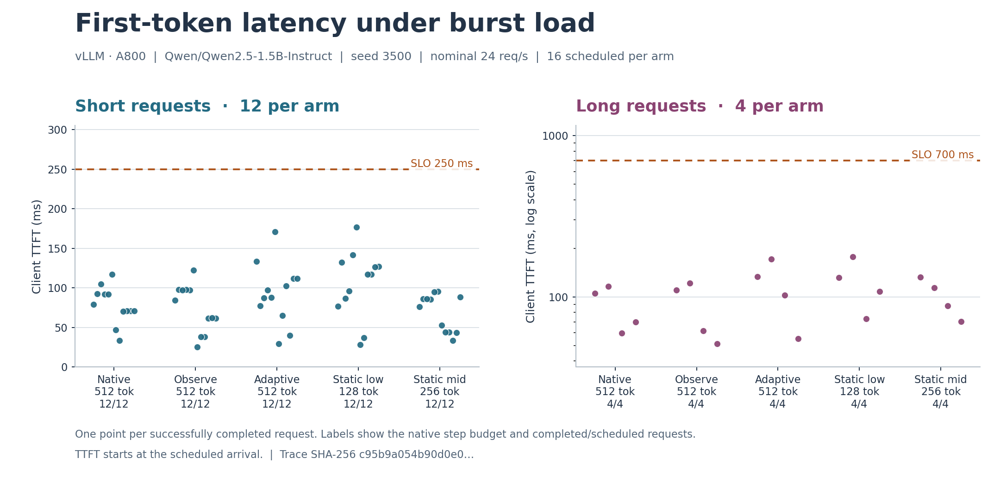

# 单卡 A800 上的 Qwen2.5-1.5B-Instruct 实测

这次突发流量下，自适应策略让短请求的 p95 TPOT 从 **11.36 ms 降到 10.47 ms**，同时让其 p95 TTFT 从 **110.24 ms 升到 150.47 ms**。原生与自适应都完成了 16 个请求，全部满足设定的双重 SLO。自适应组排空最后一个请求用时更长，goodput 从 **28.65 降到 27.17 请求/秒**。这组数字展示了一次延迟权衡；每个策略只有一个测试种子，无法据此估计跨运行的稳定收益。

## 条件与实验单位

- 使用同一张 NVIDIA A800-SXM4-80GB，驱动 570.172.08，vLLM 0.10.2，PyTorch 2.8.0，Transformers 4.57.1。实际模型 dtype 为 BF16。TP=1、同步 FCFS、eager、chunked prefill，关闭 prefix caching，`max_model_len=3072`，`max_num_seqs=32`，显存利用率配置 0.78。各臂重新启动服务并完成相同的 4 次预热；报告排除预热请求。
- 模型为 Qwen/Qwen2.5-1.5B-Instruct。输入为固定随机 token ID，greedy 解码并忽略 EOS，短类为 64 输入 / 8 输出 token，长类为 512 / 16。测试集固定 12 短、4 长，共两批，每批同时到达 8 个请求，两批间隔约 333 ms。因此负载参数 24 请求/秒与“通过数除以整段排空时间”定义的 goodput 可以不同。
- 两份独立校准流量、一个留出种子和一个正式测试种子；同一份正式 trace 在五个策略之间逐请求配对。状态表的支持门槛为每桶 2 步，单步目标 15 ms。短/长 TTFT 阈值分别为 250/700 ms，两类 TPOT 阈值均为 40 ms。正式输入摘要为 `c95b9a054b90d0e096520dd7100d5e4c81e1f527b60a6b6d0523bf0f8aaf21d5`。[模型官方说明](https://huggingface.co/Qwen/Qwen2.5-1.5B-Instruct) · [实验计划与权重指纹](../evidence/a800-qwen15b-quick/index.json)

## 五种配置的实际请求

| 配置 | 原生 token 上限 | 成功请求 | SLO 达标 | Goodput（请求/秒） | 短 TTFT p95（ms） | 短 TPOT p95（ms） | 长 TTFT p95（ms） | 长 TPOT p95（ms） | 排空窗口（秒） |
| --- | ---: | ---: | ---: | ---: | ---: | ---: | ---: | ---: | ---: |
| off | 512 | 16 | 16 | 28.65 | 110.24 | 11.36 | 114.72 | 10.44 | 0.56 |
| observe | 512 | 16 | 16 | 29.05 | 109.08 | 11.39 | 120.24 | 10.53 | 0.55 |
| adaptive | 512 | 16 | 16 | 27.17 | 150.47 | 10.47 | 165.79 | 10.26 | 0.59 |
| static-small | 128 | 16 | 16 | 26.93 | 157.47 | 10.53 | 170.28 | 10.25 | 0.59 |
| static-mid | 256 | 16 | 16 | 27.97 | 95.34 | 9.99 | 129.59 | 10.81 | 0.57 |

图中每个点对应一次成功请求，便于看到四个长请求分别落在哪里。表中的客户端分位数使用线性插值，长类的 p95 很接近一个极端样本。两条 TTFT 阈值分别对应短类和长类，判断 SLO 时还需要同时核对 TPOT。[逐请求数据与复算报告](../evidence/a800-qwen15b-quick/report.json)



## 正确性验收为何返回 2

八个轮次都完成，128 次正式请求全部成功。相对原生 `off`，完整输出 token 序列一致的请求分别为自适应 **16/16**、`observe` **15/16**、小固定预算 **13/16**、中固定预算 **13/16**。例如 `r000011` 在 `observe` 组从第 5 个输出 token 开始不同，`r000005` 在两个固定预算组分别从第 2、3 个输出 token 开始不同。因此 `all_paired_outputs_identical` 为 false，整套矩阵按设计返回 2。公开包的离线复算通过表示原始记录与报告一致。

变更批次构成、运行时到达顺序和 BF16 数值舍入都可能影响 greedy 选择。现有证据只有输出 ID 和时间，没有保存分歧步的 logits，无法把差异归因到具体 kernel 或舍入误差。进一步定位可将异常请求单独运行，再配对记录第一个分歧位置的 top-2 logits 与批次组成。这里的随机 ID 压测未评价自然语言任务质量。

## 调度机制与适用边界

1. 校准集去除预热后共有 **116 步、18 个受支持的桶**。独立留出集总体覆盖 **31/36**，混合步只有 **1/5**。在全部类别中，30 个“预测在 15 ms 内”的受支持步都满足目标，但这不能为稀疏的混合状态提供可靠的超时率估计。
2. 正式自适应运行中有 **18 个实际同时含 prefill 与 decode 的步**记录为 `reason=profile`。选择预算会改变后续状态分布，决策理由和独立留出覆盖率衡量的是不同事情。比较控制器与 `observe` 可以对齐每步写 trace 的开销；比较 `off` 则包括观测和控制两部分。
3. 两个校准轮次中，mixed 校准流量的 12 个短请求均完成，其中 2 个首个 SSE 数据包包含多个 token。客户端无法观察这两个请求的单独首 token 到达时刻，按预设口径将其记录为“无法确认达标”；保留了它们的请求成功状态。区分流式事件和 token 对低延迟模型尤其重要。
4. 若继续研究，最先要补充混合步覆盖，采集各个 decode 数、上下文长度和实际 prefill 数组合的更多独立负载。固定阈值与档位后用多个种子做成对重放，同时报告短类输出间隔与长类首 token 代价。仅比较自适应与单一原生配置，会错过静态预算本来就可能实现的效果。

## 离线复算

在项目根目录运行以下命令。第一条只需要 Python 标准库，第二条需要 Matplotlib。证据包包含逐请求计时、输出 token、引擎步和内容校验；原始服务器路径、GPU UUID、原始日志以及权重没有纳入发布材料。

```bash
python scripts/publish_evidence.py verify --bundle evidence/a800-qwen15b-quick
python scripts/plot_evidence.py --bundle evidence/a800-qwen15b-quick --out runs/review-ttft.png
```
